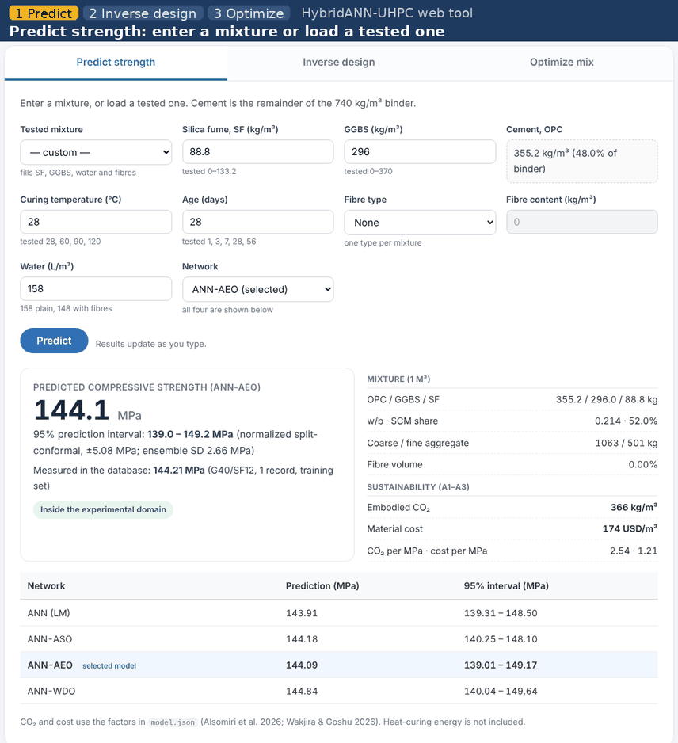
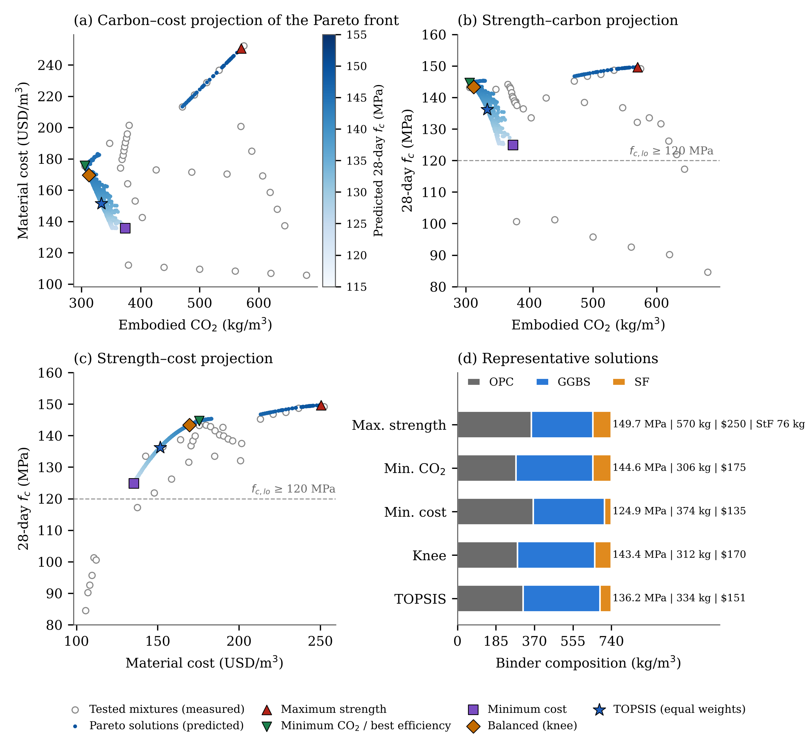

<div align="center">

# HybridANN-UHPC

### Uncertainty-Aware Hybrid Artificial Neural Networks for Strength Prediction and Mix Design Optimization of Sustainable Ultra-High-Performance Concrete

<p>
<a href="#citation">

</a>
<a href="https://ranjandivesh453.github.io/HybridANN-UHPC/">

</a>
<a href="https://ranjandivesh453.github.io/HybridANN-UHPC/#predictor">

</a>
<a href="data/Supplementary_Data_S1_Cleaned_UHPC_Database.xlsx">

</a>
</p>

**Divesh Ranjan Kumar<sup>1</sup>, Shubhum Prakash<sup>2</sup>, Teerapong Senjuntichai<sup>1,\*</sup>, Sakdirat Kaewunruen<sup>3</sup>**

<sup>1</sup>Chulalongkorn University, Thailand · <sup>2</sup>Lakshmi Narain College of Technology, India · <sup>3</sup>University of Birmingham, UK

*Journal of Asian Architecture and Building Engineering (under review)*

</div>

---

## Overview

**HybridANN-UHPC** predicts the compressive strength of UHPC made with GGBS, silica fume (SF), steel fibres and polypropylene (PP) fibres, gives calibrated 95% prediction intervals, and selects low-carbon, low-cost mixtures **inside the experimental domain**.

| Component | Description |
|-----------|-------------|
| **Hybrid ANNs** | Networks with one or two hidden layers (8 inputs) whose initial weights are searched by ASO, AEO or WDO; every network is then trained by Levenberg–Marquardt; layers, neurons, iterations and epochs are selected by grouped cross-validation; each model is a ten-network ensemble, and an LM-trained ANN ensemble is the reference |
| **Mixture-level validation** | 28 / 5 / 5 training / validation / test mixtures (277 / 52 / 52 records), grouped CV, ten-network ensembles, leave-one-mixture-out (LOMO) CV, MLR / RF / GPR baselines |
| **Calibrated uncertainty** | Split-conformal 95% intervals scaled by the ensemble spread (PICP with Clopper–Pearson CI, MPIW, Winkler score, calibration) |
| **Sustainability** | Cradle-to-gate (A1–A3) embodied CO₂ and material cost of every mixture |
| **Mix optimization** | NSGA-III maximizes strength and minimizes CO₂ and cost under domain constraints; representative solutions and TOPSIS ranking |
| **Web tool** | Browser-based predictor, inverse design and TOPSIS optimizer: no installation, no server |

<p align="center"></p>
<p align="center"><em>Animated demonstration (Supplementary Animation S2). Static view: <a href="assets/web_tool.png">assets/web_tool.png</a></em></p>

## Key results

| Model | Test R² | Test RMSE (MPa) | LOMO RMSE (MPa) | PICP (%) | MPIW (MPa) |
|-------|---------|-----------------|-----------------|----------|------------|
| ANN (LM) ensemble | 0.997 | 2.22 | 2.84 | 98.1 | 11.79 |
| ANN-ASO ensemble | 0.997 | 2.16 | 2.94 | 100.0 | 11.81 |
| **ANN-AEO ensemble (selected)** | 0.997 | 2.13 | 3.33 | 100.0 | 10.12 |
| ANN-WDO ensemble | 0.997 | 2.02 | 3.02 | 100.0 | 10.29 |
| MLR (baseline) | 0.964 | 7.38 | 8.52 | 96.2 | 29.12 |
| Random forest (baseline) | 0.991 | 3.60 | 4.38 | 98.1 | 19.20 |
| GPR (baseline) | 0.996 | 2.34 | 3.56 | 96.2 | 9.88 |

* Data: 395 raw laboratory records → 381 after removing 13 exact duplicates and 1 near-duplicate (38 mixtures).
* Test RMSE (ten-network ensembles): ANN-WDO 2.02, ANN-AEO 2.13, ANN-ASO 2.16, ANN (LM) 2.22 MPa; GPR 2.34, RF 3.60, MLR 7.38 MPa. ANN-AEO was selected on the validation mixtures; on the test mixtures it was significantly more accurate than RF and MLR (Wilcoxon, p < 0.05) but not significantly different from ANN (LM), ANN-ASO, ANN-WDO and GPR. Under LOMO, the ANN (LM) ensemble generalized best.
* 40–50% GGBS + 12% SF cut embodied CO₂ from 680 to 306–366 kg/m³ while raising 28-day strength from 84.6 to 143–144 MPa.
* NSGA-III returned **725 Pareto-optimal mixtures** (hypervolume ratio 0.999 to an exhaustive enumeration). The lowest-carbon solution is the tested **G50/SF12** mixture (143.25 MPa measured, 306 kg CO₂/m³); the equal-weight TOPSIS compromise (50% GGBS, 7.4% SF) is 14% cheaper for 6% lower predicted strength.

<p align="center"></p>

## Repository structure

```
HybridANN-UHPC/
├── index.html, app.js            project page and web tool (GitHub Pages)
├── inference.js, topsis.js       forward pass, CO2/cost, domain checks, TOPSIS, inverse design
├── model.js / model.json         trained networks, scaling, conformal half-widths, domain, factors
├── pareto_data.js                Pareto-optimal mixtures used by the web tool
├── code/
│   ├── uhpc_ann.py               ANN, LM, ASO, AEO and WDO
│   ├── reproduce.py              retrains all models; Tables 8, 13, 14 and importance
│   ├── importance.py             design-factor importance and measured effects (Figure 19)
│   ├── export_models.py          ten-network ensembles -> model.json, model.js, MATLAB .mat
│   └── optimize_mix.py           NSGA-III, representative solutions, TOPSIS, inverse design
├── data/
│   ├── Supplementary_Data_S1_Cleaned_UHPC_Database.xlsx
│   ├── uhpc_raw_dataset_395.csv  raw laboratory records (before cleaning)
│   ├── uhpc_database_cleaned.csv 381 records used for modelling
│   └── material_factors.csv      densities, CO2 factors and unit costs with sources
├── results/                      CSV/JSON outputs of the scripts
├── matlab/                       UHPC_predict.m, UHPC_inverse_design.m, UHPC_models.mat
└── assets/                       figures and animated web-tool demo (web_tool_demo.gif)
```

## Quick start

```bash
pip install -r requirements.txt
python code/reproduce.py        # all models and Tables 8, 13, 14   (several hours, 2 cores)
python code/importance.py       # Figure 19 importance values        (~1 min)
python code/export_models.py    # model.json, model.js, matlab/UHPC_models.mat   (<1 min)
python code/optimize_mix.py     # Pareto set, Tables 15-16, Figure 24   (~2 min)
python -m http.server 8000      # then open http://localhost:8000/#predictor
```

The scripts are deterministic: re-running them reproduces the published weights and Pareto set exactly.
The web tool reproduces the Python predictions to within 1e-12 MPa.

MATLAB:

```matlab
cd matlab
[cs, lo, hi, sd] = UHPC_predict([158 281.2 88.8 370 28 28 0 0])   % G50/SF12: 144.6 MPa, 95% PI 139.2-150.1
best = UHPC_inverse_design(130)                          % lowest-CO2 grid design with lower bound >= 130 MPa
```

Inputs are `[W C SF GGBS T Age StF PPF]` in L/m³, kg/m³ (C = 740 − SF − GGBS), kg/m³, kg/m³, °C, days, kg/m³, kg/m³.

## Applicability domain

The models were trained on one laboratory's materials: binder 740 kg/m³, w/b 0.200–0.214, SF 0–133.2 kg/m³, GGBS 0–370 kg/m³,
one fibre type per mixture (steel 0.5–1.0 vol.%, PP 0.2–1.0 vol.%, only with the G40/SF12 binder at 28 °C, plus 1.0% steel at 120 °C),
12.5 mm coarse aggregate, curing 28–120 °C and ages 1–56 days. The web tool flags inputs outside the training ranges, outside the convex hull of
tested binders or farther from the training data than the 95th-percentile nearest-neighbour distance (0.26). Interpolated optimal mixtures have not
been cast and should be confirmed experimentally. Unit costs are indicative (Wakjira & Goshu 2026; PP fibre assumed) and can be edited in
`code/export_models.py`.

## Publishing the project page (GitHub Pages)

1. Create a public repository named `HybridANN-UHPC` and upload all files (keep the folder structure; `index.html` must be in the root).
2. **Settings → Pages → Build and deployment → Source: Deploy from a branch → Branch: `main` / `(root)` → Save.**
3. After about a minute the page is live at `https://ranjandivesh453.github.io/HybridANN-UHPC/` and the tool at `https://ranjandivesh453.github.io/HybridANN-UHPC/#predictor`.
4. Optional DOI: connect the repository in Zenodo (GitHub integration), then create a GitHub release; Zenodo archives it and issues a DOI.

## Citation

```bibtex
@article{kumar2026hybridann,
  title   = {Uncertainty-aware hybrid artificial neural networks for strength
             prediction and mix design optimization of sustainable
             ultra-high-performance concrete},
  author  = {Kumar, Divesh Ranjan and Prakash, Shubhum and
             Senjuntichai, Teerapong and Kaewunruen, Sakdirat},
  journal = {Journal of Asian Architecture and Building Engineering},
  year    = {2026},
  note    = {Under review}
}
```

The optimization workflow and the format of the web tool follow Wakjira & Goshu,
*CompMoE*, Materials Today Advances 32 (2026) 100944, https://doi.org/10.1016/j.mtadv.2026.100944.

## License

Code and trained models: free for non-commercial research, teaching and academic use, with citation of the article (see `LICENSE`); commercial use requires written permission. Data (Supplementary Data S1): CC BY 4.0.
